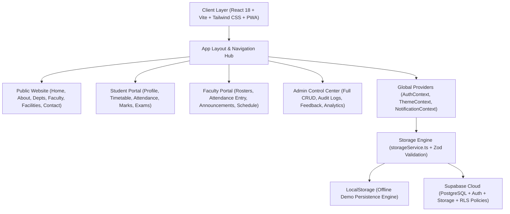

# CampusOne — Your Entire Campus. One Platform.

[](https://reactjs.org/)
[](https://www.typescriptlang.org/)
[](https://vitejs.dev/)
[](https://tailwindcss.com/)
[](https://zod.dev/)
[](https://supabase.com/)
[](https://web.dev/progressive-web-apps/)

**CampusOne** is a full-stack, production-minded college campus information and management SaaS platform. Designed for higher education institutions to bring students, faculty, and administrators together under a unified, role-based, accessible digital platform.

---

## 🏛️ System Architecture



---

## 📋 Comprehensive Phase Breakdown

### Phase 1 — Project Planning & Structure
- **Framework**: React 18 with TypeScript and Vite.
- **Styling**: Tailwind CSS with custom navy (`#0B192C`, `#102a43`) and cyan accents (`#00ADB5`).
- **Data Architecture**: Dual-engine architecture supporting both live Supabase PostgreSQL (with Row Level Security) and local persistent offline demo mode with zero setup required.
- **Validation**: Schema-level validation using Zod.

### Phase 2 — Visual Design & SaaS UX
- Collapsible responsive sidebar on desktop and overlay drawer on mobile.
- Notification center drawer with unread badges, bookmarks modal, and quick profile menu.
- Complete Light and Dark Mode toggle with persistent preference.
- Global Search modal (`Cmd+K` / `Ctrl+K`) with keyboard navigation.
- Breadcrumb navigation component for clear backtracking.

### Phase 3 — Public Website Pages
1. **Home (`/`)**: Hero section, global search, 8 quick-access portal cards, today's schedule widget, urgent announcements ticker, upcoming events carousel, campus news, and 24/7 emergency contact bar.
2. **About CampusOne (`/about`)**: Digitalization benefits, zero-trust authorization overview, institutional heritage (Apex Institute, Est. 1994, NAAC A++), and academic leadership.
3. **Departments (`/departments`)**: CSE, AI & Data Science, Electronics, and Mechanical Engineering with HOD info, student/faculty headcount, research labs, and degree programs.
4. **Faculty Directory (`/faculty`)**: Searchable profiles, designations, cabin numbers, consultation hours, and "Book Office Hours Consultation" scheduler.
5. **Campus Facilities (`/facilities`)**: Central Library, NVIDIA Supercomputing Lab, Steve Jobs Auditorium, Olympic Sports Complex, Food Court, and 24/7 Medical Center.
6. **Notices and Events (`/notices`, `/events`)**: Searchable notices with category/department filters, attachments download, and event RSVP pass generation with confetti.
7. **Contact and Help (`/contact`)**: Office directory, direct helplines, validated feedback and grievance submission form, and searchable FAQs.

### Phase 4 — Authentication & Role-Based Authorization
- **Interactive Persona Simulator**: Immediate one-click switching in demo mode between:
  - **Student**: Aarav Sharma (B.Tech CSE, Sem 6, Roll `21CS104`, PRN `2021016400987654`)
  - **Faculty**: Dr. Radhika Sen (Associate Professor & AI Lab Head)
  - **Administrator**: Prof. K. Verma (Dean of Academic Affairs)
  - **Guest / Prospective Student**: Visitor view
- **Role Permissions Guard**: Protected routes ensure students cannot access faculty attendance registers or administrator control panels.
- **Database-Level RLS**: PostgreSQL Row Level Security policies enforce that students can read only their own private marks, attendance records, and personal profiles.

### Phase 5 — Student Dashboard
- Student identity card with roll number, PRN, branch, semester, division, CGPA, and mentor.
- Monday to Saturday class timetable with room numbers and printable view.
- **Attendance Tracker with Bunk / Recovery Calculator**: Circular percentage dials, safety thresholds (minimum 75%), safe bunk margins, and required classes to recover eligibility.
- **Internal Marks & Results**: Midterms, quizzes, lab marks, and an end-sem target grade calculator predicting marks needed for $A+$ or $A$ grades.
- **Assignments Tracker**: Deadlines countdown, submission status, and interactive file archive submission.
- **Study Materials Hub**: Downloadable lecture notes, official syllabi, and 5-year solved question papers (PYQs).
- **Exam Center & Digital Hall Ticket**: Seat row assignments and institutional Admit Card generator with QR code and print support.
- **Academic Calendar**: Monthly calendar grid and agenda list covering college holidays and exam periods.

### Phase 6 — Dedicated Faculty Portal
- **Faculty Profile & Assigned Classes**: Overview of active modules (Distributed Systems CS601, AI Lab CS606, Capstone Project CS608).
- **Interactive Daily Attendance Entry**:
  - Class selector, session date, slot, and lecture topic.
  - Student roster with one-click toggles: `Present`, `Late`, `Absent`.
  - "Mark All Present" shortcut.
  - "Commit & Save Attendance Session" button that updates student attendance percentages, logs to security audit trail, and dispatches student notifications.
- **Course Announcements Broadcaster**: Direct publication of class notices to enrolled students.
- **Faculty Schedule**: Personalized weekly teaching timetable.

### Phase 7 — Admin Control Center (Full CRUD)
- **Platform Analytics**: Active online students counter, notice views, weekly traffic bar chart, and department engagement breakdown.
- **Manage Notices**: Create with urgency flag and attachments, edit, and delete.
- **Manage Events**: Add hackathons/workshops, update venues, and set registration caps.
- **Manage Faculty**: Add, edit designations, cabin numbers, and consultation hours.
- **Upload Materials**: Add notes, syllabi, or question papers.
- **Student Accounts & Permissions**: View student directory, PRN numbers, CGPA, and toggle access privileges.
- **Grievance Desk**: Inspect student inquiries and update resolution status (`Pending`, `In Review`, `Resolved`).
- **Security Audit Logs**: Immutable log of notice publications, attendance commits, user privilege modifications, and grade revisions.
- **System Settings**: Supabase connectivity status, JSON backup export, and one-click demo data reset.

### Phase 8 — Global Campus Search
- Powered by `Cmd+K` / `Ctrl+K` shortcut and navbar search trigger.
- Instant search across notices, events, faculty members, subjects, facilities, and study materials.
- Category filters, keyboard navigation (`↑`, `↓`, `Enter`, `ESC`), and direct item navigation.

### Phase 9 — PostgreSQL Database Schema & Migrations
- **Version-Controlled Migrations**: `supabase/migrations/20261026000000_campusone_core_schema.sql` and `supabase/schema.sql`.
- **Database Tables**: `profiles`, `departments`, `programs`, `faculty_directory`, `subjects`, `class_sections`, `timetables`, `attendance_sessions`, `attendance_records`, `student_subject_attendance`, `marks`, `assignments`, `assignment_submissions`, `notices`, `events`, `event_registrations`, `study_materials`, `facilities`, `feedback`, and `audit_logs`.
- **Enums**: `user_role_type`, `attendance_status_type`, `notice_category_type`, `material_type`, `feedback_status_type`.
- **Row Level Security (RLS)**: Enabled across all tables with least-privilege policies.
- **Storage Buckets**: Pre-configured policies for `avatars`, `study_materials`, `notice_attachments`, and `assignment_submissions`.
- **Database Triggers**:
  - `handle_new_user()`: Automatically provisions a profile row on auth signup and forces `'student'` role to strictly prevent privilege escalation.
  - `prevent_role_escalation()`: Database-level guard ensuring only existing administrators can update roles.
- **Seed Data**: Complete college initial seed dataset in `supabase/seed.sql`.

### Phase 10 — Sample Data & Dual Backend Architecture
- **Supabase Live Cloud Mode**: Enabled when valid `VITE_SUPABASE_URL` and `VITE_SUPABASE_PUBLISHABLE_KEY` are provided. Executes real queries, propagates errors truthfully, and persists data directly to PostgreSQL.
- **Local Demo Mode**: Active when Supabase credentials are not configured or when testing offline. Utilizes a high-performance, persistent browser storage engine with pre-populated college data for Apex Institute of Technology & Science.

### Phase 11 — Quality & Validation
- Zod schema validation on forms (`noticeSchema`, `eventSchema`, `facultySchema`, `studyMaterialSchema`, `feedbackSchema`, `attendanceSessionSchema`).
- Accessible semantic markup, responsive layouts, empty states, and toast notifications.

### Phase 12 — Testing & Verification
- Comprehensive automated verification suite (`npm test`) validating 67 integration requirements including environment safety, SQL migrations, RLS policies, auth methods, and CRUD mappers.
- Production build verified with zero TypeScript compilation errors (`npm run build`).

---

## 🚀 Quick Start Guide

### 1. Prerequisites
- Node.js 18+ (Node 24 tested)
- npm 9+

### 2. Install & Run
```bash
# Navigate to project
cd "campus one web"

# Install dependencies
npm install

# Run automated integration tests
npm test

# Start development server
npm run dev
```
Open [http://localhost:5173](http://localhost:5173) in your browser.

### 3. Production Build
```bash
npm run build
```
Creates an optimized production bundle in `dist/`.

---

## ☁️ Connecting Supabase Live Backend

To connect CampusOne to a live Supabase cloud project:

1. Create a project at [supabase.com](https://supabase.com).
2. Go to the **SQL Editor** tab in your Supabase dashboard and run:
   - `supabase/migrations/20261026000000_campusone_core_schema.sql` (or `supabase/schema.sql`)
   - Optionally run `supabase/seed.sql` to populate sample departments, faculty, notices, events, and facilities.
3. Create a local `.env.local` file (this file is ignored by Git to protect secrets):
   ```bash
   cp .env.example .env.local
   ```
4. Fill in your project credentials from **Project Settings > API**:
   ```env
   VITE_SUPABASE_URL=https://your-project-id.supabase.co
   VITE_SUPABASE_PUBLISHABLE_KEY=your-publishable-key-here
   ```
5. Restart Vite (`npm run dev`). CampusOne will immediately detect the live backend, activate **Supabase Live Cloud** mode, and authenticate via Supabase Auth.
6. Verify connectivity anytime by opening **Admin Dashboard > System Settings** and clicking **Test Ping**.

---

## 🔐 Institutional Security & Administrator Provisioning

- **No Self-Privilege Escalation**: Public registration strictly assigns the `'student'` role. The database trigger `handle_new_user()` overrides any client-supplied role metadata.
- **Least-Privilege RLS**:
  - Students can only view their own private marks, attendance records, and assignment submissions.
  - Faculty can create notices, record attendance, and grade submissions.
  - Public users can only read general information (departments, public notices, events).
- **Initial Administrator Account**:
  - The default system administrator email configured in the migration trigger is `admin@campusone.edu`. When this email registers, it is automatically granted the `'admin'` role.
  - Alternatively, in your Supabase Dashboard, navigate to **Table Editor > profiles**, find the user profile, and update `role` to `'admin'`.
- **Zero Secrets in Frontend**: Service-role keys, database passwords, and root credentials must NEVER be placed in frontend environment files. CampusOne operates entirely through the public key with PostgreSQL Row Level Security.
